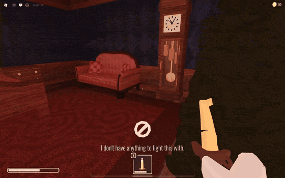
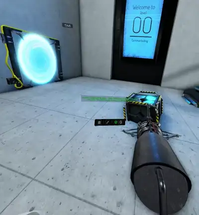

<div align="center">


### Run Roblox natively on Linux.

[Releases](https://github.com/gpt4omni/vanta/releases/latest) · [Install](#install) · [Docs](docs/README.md) · [Discord](https://discord.gg/Jt5MW7UBsC)

</div>

Vanta runs Roblox's official, unmodified Android client directly on x86-64 and ARM64 Linux with no emulator, Wine, or virtual machine. On first launch, fetch the signature-verified Android APK directly or import an existing build from [Sober](https://sober.vinegarhq.org/).

## What you get

- **Fast by default, plus Speed mode.** Runs Roblox natively on Vulkan/Wayland and X11, with a dedicated **Speed** launch mode built for old and weak CPUs.
- **FastFlags that actually stick.** Layered per-profile `flags.json` that survives Roblox's periodic flag refresh, with `DFIntDebugFRMQualityLevelOverride` preserving full render distance automatically.
- **Built-in WebView.** Sign-in, captchas, Servers, and Roblox pages open inside Vanta instead of kicking you to an external browser.
- **Live Performance HUD and recording.** Press `F8` for live FPS, 1% lows, and frametime; press `F9` to record gameplay with game audio.
- **Non-destructive asset mods.** Swap fonts, cursors, sounds, skies, and textures from Settings without touching the APK. Survives every Roblox update.
- **Server region and quick rejoin.** Resolves your server region locally with zero tracking, plus one-click copy invite and quick rejoin.
- **Profiles, plugins, and VR.** Run multiple accounts side by side, extend Vanta with sandboxed Deno plugins, or play Meta Quest VR over OpenXR.
- **Open source.** GPL-3.0, zero in-process hooking or memory patching of Roblox, and GPG-signed packages for x86-64 and ARM64.

## Install

**One-line installer (recommended):**

```bash
curl -fsSL https://gpt4omni.github.io/vanta/install.sh | bash
```

Auto-detects your distro and CPU architecture (`x86_64` or `aarch64`), verifies Vanta's signing key, and installs via Flatpak, APT, DNF, Pacman, or AppImage.

| Platform | Command |
| :--- | :--- |
| **Flatpak** (x86-64 & ARM64) | `flatpak remote-add --if-not-exists vanta https://gpt4omni.github.io/vanta/vanta.flatpakrepo && flatpak install vanta io.github.gpt4omni.Vanta` |
| **Debian / Ubuntu** (APT) | `curl -fsSL https://gpt4omni.github.io/vanta/install.sh \| bash -s -- --method apt` |
| **Fedora 44** (DNF) | `sudo curl -fsSL https://gpt4omni.github.io/vanta/vanta.repo -o /etc/yum.repos.d/vanta.repo && sudo dnf install vanta` |
| **Arch Linux** (Pacman) | `curl -fsSL https://gpt4omni.github.io/vanta/install.sh \| bash -s -- --method pacman` |
| **AppImage** (x86-64 & ARM64) | Download `Vanta-*.AppImage` from [Releases](https://github.com/gpt4omni/vanta/releases/latest), `chmod +x Vanta-*.AppImage && ./Vanta-*.AppImage` |
| **Nix Flake** (x86-64 & ARM64) | `nix build '.?submodules=1#vanta'` |

See [docs/install.md](docs/install.md) for manual APT/Pacman repo setup, GPG fingerprints, cosign verification, and building from source.

## Demo

<div align="center">
<table>
  <tr>
    <td align="center" width="58%">
      
      <br>
      <sub><b>Roblox DOORS</b> running natively on Linux (<a href="docs/media/vanta-doors.mp4">full video</a> · <a href="docs/media">more media</a>)</sub>
    </td>
    <td align="center" width="42%">
      
      <br>
      <sub><b>Meta Quest VR</b> playing <a href="https://www.roblox.com/games/4635669637/TUNNELER">TUNNELER</a> (<a href="docs/media/vanta-vr.mp4">full video</a> · <a href="docs/vr.md">VR guide</a>)</sub>
    </td>
  </tr>
</table>
</div>

## Shortcuts

| Shortcut / Command | What it does |
| :--- | :--- |
| **`F8`** | Toggle the live Performance HUD (FPS, 1% lows, frametime) |
| **`F9`** | Start or stop built-in gameplay recording with game audio |
| **Settings > Mods** | Manage non-destructive font, cursor, sound, sky, and texture overrides |
| **Settings > FastFlags** | Edit layered per-profile FastFlags or import from Bloxstrap, Fishstrap, and Sober |
| **`vanta --doctor`** | Check your display, Vulkan, audio, keyring, and Roblox setup |

## Documentation

- [Install & Repo Setup](docs/install.md) - Flatpak, APT, DNF, Pacman, AppImage, Nix, GPG keys, and building from source.
- [FastFlags](docs/fastflags.md) - Layered `flags.json`, presets, and preserving render distance.
- [Asset Mods](docs/asset-overrides.md) - Custom fonts, cursors, sounds, skies, and textures.
- [Recording](docs/recording.md) - Built-in `F9` capture with game audio.
- [Meta Quest VR](docs/vr.md) - Running Roblox VR over OpenXR and WiVRn.
- [Multi-Account & PartyDeck](docs/partydeck.md) - Side-by-side profiles and gamescope setup.
- [Full Docs Index](docs/README.md) - Architecture, ADRs, plugins, controllers, and troubleshooting.

## Contributing & Community

Found a bug or want to help build Vanta? Read [CONTRIBUTING.md](CONTRIBUTING.md), open an issue on [GitHub Issues](https://github.com/gpt4omni/vanta/issues/new/choose) (attach `vanta --diagnostics`), or join the community on [Discord](https://discord.gg/Jt5MW7UBsC).

## Notes & License

Vanta is not affiliated with Roblox Corporation, ships no Roblox code or assets, and is not a cheat or injector (it never patches or hooks `libroblox.so`).
Forked from [Cordial](https://github.com/luohoa97/cordial) and inspired by [Sober](https://sober.vinegarhq.org/).
Licensed under GPL-3.0-or-later ([LICENSE](LICENSE)), except [crates/vanta-protocol](crates/vanta-protocol) which is dual-licensed MIT OR Apache-2.0.
